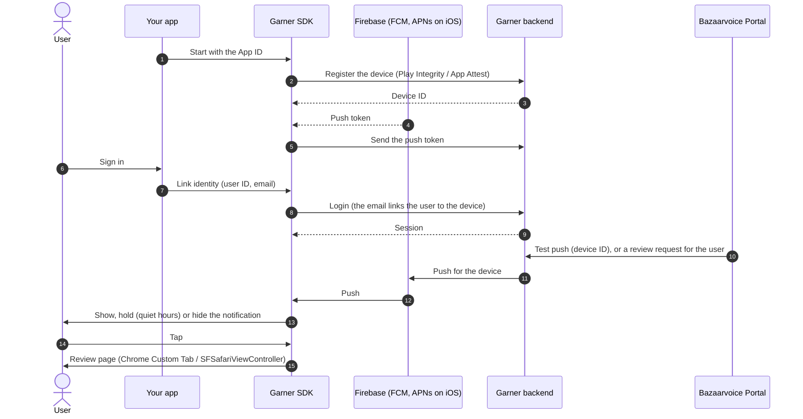

# BV Garner

Push notifications for Bazaarvoice review requests, on Android and iOS. This repository has two
parts:

| Part | Folder | What it is |
|---|---|---|
| **BV Garner SDK** (iOS & Android) | [`bv-push-sdk/`](bv-push-sdk) | What your app adds. It registers the device with the Garner backend, links the signed-in consumer, shows review-request pushes (with opt-out and quiet hours) and opens the review page when the consumer taps one |
| **BV Garner Test Apps** (iOS & Android) | [`test-app/`](test-app) | Small apps that run the SDK with your own Firebase project and Portal push sender profile, so you can see a push arrive before you wire the SDK into your app. See [BV Garner Test Apps](#bv-garner-test-apps) |

| Platform | Get the SDK | Requires |
|---|---|---|
| Android | Maven Central: `com.bazaarvoice:bv-garner-sdk-android` | `minSdk 24` |
| iOS | Swift package: `https://github.com/bazaarvoice/garner.git`, product `BVGarner` | iOS 15, Xcode 16 |

Both platforms share one version number. See [CHANGELOG.md](CHANGELOG.md) for releases.

## Install

### Android

```kotlin
// settings.gradle.kts
dependencyResolutionManagement {
    repositories {
        google()
        mavenCentral()
    }
}

// app/build.gradle.kts
dependencies {
    implementation("com.bazaarvoice:bv-garner-sdk-android:1.1.0")
}
```

### iOS

In Xcode, **File → Add Package Dependencies…**, enter `https://github.com/bazaarvoice/garner.git`
and pick **Up to Next Major Version** from `1.1.0`. Add the `BVGarner` product to your app
target, plus `BVGarnerFirebase` if you use Firebase Messaging. In a `Package.swift`:

```swift
.package(url: "https://github.com/bazaarvoice/garner.git", from: "1.1.0")
// target dependency:
.product(name: "BVGarner", package: "garner")
```

### React Native

There's no separate React Native package: a React Native app uses the Android and iOS SDKs above
in its `android/` and `ios/` projects. Start the SDK in `MainApplication.onCreate` (Android) and
in `AppDelegate` (iOS), and call `linkIdentity` / `unlinkIdentity` from a small native module
when the user signs in or out. With Expo, use a development build (`npx expo prebuild`); Expo Go
can't load native SDKs. See React Native in the
[Android](docs/android-integration-guide.md#react-native) and
[iOS](docs/ios-integration-guide.md#react-native) guides.

## Quick start

Your App ID is the 8-digit id that Bazaarvoice Portal shows for your app.

```kotlin
// Android: Application.onCreate
BVPush.init(this, 10000001)
// sign-in / sign-out
BVPush.linkIdentity(userId, email)
BVPush.unlinkIdentity(userId)
```

```swift
// iOS: AppDelegate
import BVGarner
import BVGarnerFirebase

BVPush.configure(appId: 10000001)
BVPushUserNotificationCenterProxy.install()
BVPush.requestNotificationAuthorization()
// APNs token:  BVPushFirebase.didRegisterForRemoteNotifications(deviceToken: token)
// FCM token:   BVPushFirebase.didReceiveRegistrationToken(fcmToken)
// remote push: BVPushBackground.didReceiveRemoteNotification(userInfo, completion: completionHandler)
// sign-in / sign-out
try BVPush.linkIdentity(userId: userId, email: email)
BVPush.unlinkIdentity()
```

There's no "register" call: once the SDK is started and a push token exists, it registers the
device, sends the token and signs the consumer in by itself, in the background.

## How it works



- The SDK never logs in before it has a device ID and has sent the push token. A sign-in before
  that waits and runs by itself.
- A test push shows even when no user is signed in. Sign-out removes the user and the session;
  the device stays registered.
- The SDK holds no app ids, keys or project numbers: your app passes them in.

## Documentation

| Guide | What's in it |
|---|---|
| [Android integration guide](docs/android-integration-guide.md) | Dependency, init, Play Integrity, Firebase, identity, permissions |
| [iOS integration guide](docs/ios-integration-guide.md) | Swift package, capabilities, App Attest, Firebase token forwarding, extensions |
| [API reference](docs/api-reference.md) | Every host-app call on Android and iOS, side by side |
| [Privacy](docs/privacy.md) | What leaves the device, what's stored, platform declarations |
| [Troubleshooting](docs/troubleshooting.md) | No token, no pushes, refusals, package resolution |

## Repository layout

| Path | What's in it |
|---|---|
| **BV Garner SDK** | |
| `bv-push-sdk/sdk` | The SDK engine in Kotlin Multiplatform: Android library and iOS XCFramework (`BVGarnerKit`), with its tests |
| `bv-push-sdk/ios/Sources` | The Swift layer of the iOS SDK: `BVGarner`, `BVGarnerFirebase`, `BVGarnerNotificationService` |
| `Package.swift` | The Swift package (products above, plus `BVGarnerKit` as a binary target) |
| **BV Garner Test Apps** | |
| `test-app/android` | BV Garner, the Android test app ([README](test-app/android/README.md)) |
| `test-app/ios` | BV Garner, the iOS test app ([README](test-app/ios/README.md), [real push on an iPhone](test-app/ios/NEXT-STEPS.md)) |
| **Docs** | |
| `docs` | Integration guides, API reference, privacy, troubleshooting |

## Build from source

You need JDK 17. Android also needs the Android SDK (API 37); iOS needs a Mac with Xcode 16.2 or
later.

```sh
cd bv-push-sdk
./gradlew check                                       # JVM unit tests and checks
./gradlew :sdk:assembleRelease                        # Android library (AAR)
./gradlew :sdk:assembleBVGarnerKitDebugXCFramework    # iOS engine: sdk/build/XCFrameworks/debug
./gradlew :sdk:connectedAndroidTest                   # device tests on a running emulator
```

Most device tests run on any emulator; some need a Garner backend or an image server on the
emulator host and skip when it isn't there.

A released `Package.swift` takes `BVGarnerKit` from the GitHub release of its version. To run
your own engine build in an iOS app, point the binary target at it:

```swift
.binaryTarget(
    name: "BVGarnerKit",
    path: "bv-push-sdk/sdk/build/XCFrameworks/debug/BVGarnerKit.xcframework"
),
```

## BV Garner Test Apps

BV Garner is a small app for Android and iOS that runs the SDK against your Firebase project and
your Portal push sender profile: Home (is this device ready), Account (sign in, opt in or out,
quiet hours), Inbox (every push the SDK reported) and Details (every value support asks for).
The Android app builds the SDK from this repository; the iOS workspace builds the Swift sources
of this repository. Neither has credentials in it: you add your own `google-services.json`,
`GoogleService-Info.plist`, App ID and team. See [test-app/android](test-app/android/README.md)
and [test-app/ios](test-app/ios/README.md).

## Versioning

Releases follow [Semantic Versioning](https://semver.org). The Android artifact and the Swift
package always have the same version; `SdkInfo.VERSION` (Android) and `BVPushVersion.version`
(iOS) report it at runtime. Pre-releases end in `-rc.n`.

## Support

Contact your Bazaarvoice representative.

## License

See [LICENSE](LICENSE). Use of the SDK is subject to the
[Bazaarvoice API Terms of Use](https://www.bazaarvoice.com/legal/terms-of-use/api/).
